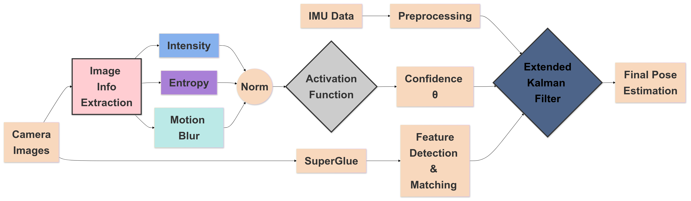
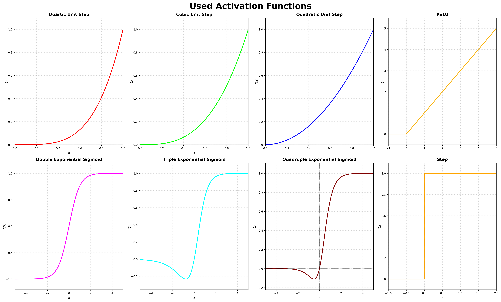
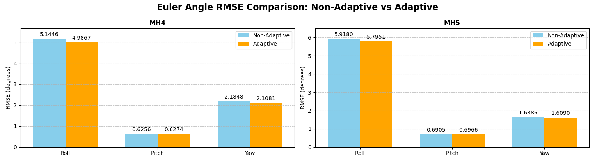
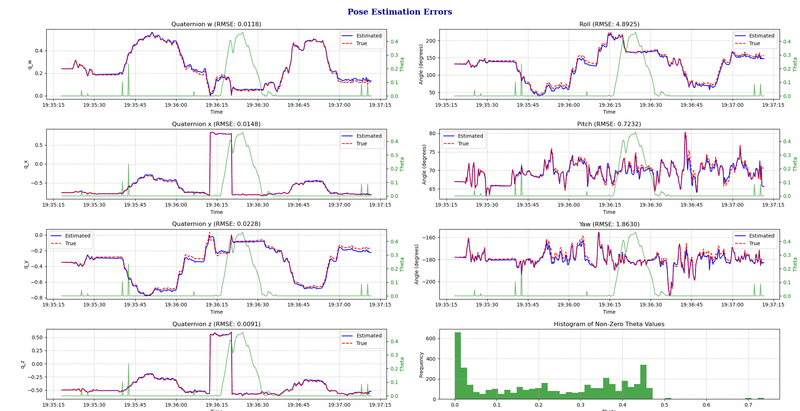

# Adaptive Visual-Inertial Odometry Using SuperGlue and Dynamic EKF with Information-Based Confidence Estimation

[](LICENSE)

> **This project has moved.** Development continues in
> [Adaptive-Covariance-and-Quaternion-Focused-Hybrid-Error-State-EKF-UKF-for-Visual-Inertial-Odometry](https://github.com/ufukasia/Adaptive-Covariance-and-Quaternion-Focused-Hybrid-Error-State-EKF-UKF-for-Visual-Inertial-Odometry).
> This repository is kept as the code of the earlier preprint described below.

This repository contains the code of an adaptive visual-inertial fusion scheme evaluated on the
EuRoC MAV dataset. SuperGlue matches features between consecutive camera frames, and an Extended
Kalman Filter (EKF) fuses the visual and inertial updates of the attitude quaternion. An
information-based confidence score θ, computed from the image intensity change, entropy and motion
blur, decides how strongly the camera update is trusted: in degraded frames the filter shifts weight
towards the IMU. The estimate is evaluated against the EuRoC ground truth in terms of quaternion and
Euler-angle RMSE.



## Method overview

- **Ground-truth alignment** – the ground truth is shifted by the camera–IMU time offset
  (`5.63799926987e-05` s) and interpolated onto the IMU timestamps; fixed bias offsets are subtracted
  from the gyroscope and accelerometer readings.
- **Feature matching** – SuperPoint + SuperGlue (`indoor` weights, `max_keypoints=1000`,
  `keypoint_threshold=0.005`, `nms_radius=4`, 20 Sinkhorn iterations, `match_threshold=0.2`) between
  consecutive `cam0` frames; matches displaced by 5 px or more are discarded.
- **Information-based confidence** – for each image the scores
  `α·10·Δintensity`, `β·(1 − entropy/8)` and `γ·0.2·motion blur` (Laplacian variance) are computed and
  their maximum is compared with `theta_threshold`; above the threshold, θ is obtained by passing the
  excess through the selected activation function, otherwise θ = 0.
- **Adaptive EKF** – the attitude quaternion is propagated with the gyroscope and corrected with the
  accelerometer and a PnP-based camera measurement. Camera and IMU updates are averaged with equal
  weights when θ ≤ `theta_threshold`, the camera weight decreases linearly as θ grows, and above
  θ = 0.5 only the IMU update is used.

Activation functions available for the confidence estimation:



## Installation

```bash
git clone https://github.com/ufukasia/Adaptive-VIO-Odometry.git
cd Adaptive-VIO-Odometry
```

Install PyTorch following the [official instructions](https://pytorch.org/get-started/locally/).
A GPU is **highly recommended**; the author reports that it runs about 20x faster with a GPU. For
example, with CUDA 11.8:

```bash
pip3 install torch torchvision torchaudio --index-url https://download.pytorch.org/whl/cu118
```

or, for CPU only:

```bash
pip3 install torch torchvision torchaudio
```

Then install the remaining dependencies:

```bash
pip install -r requirements.txt
```

The pretrained SuperPoint and SuperGlue weights are included in `models/weights/`.

## Dataset preparation

The code uses the [EuRoC MAV dataset](https://projects.asl.ethz.ch/datasets/doku.php?id=kmavvisualinertialdatasets)
in ASL format. A sequence is expected at `<dataset_path>/<sequence>/mav0/` with:

```
<sequence>/mav0/
├── cam0/
│   ├── data.csv
│   ├── sensor.yaml
│   └── data/<timestamp>.png
├── imu0/data.csv
└── state_groundtruth_estimate0/data.csv
```

If the sequence folder does not exist (or `--download` is given), `main.py` tries to download and
extract `<sequence>.zip` from the original ETH server (`http://robotics.ethz.ch/~asl-datasets/...`).
If that server is not reachable, download the sequence manually and extract it into the layout above.
Sequence names must start with `MH_`, `V1_` or `V2_` (e.g. `MH_03_medium`, `V1_01_easy`).

## Usage

```bash
python main.py [OPTIONS]
```

| Option | Default | Description |
|---|---|---|
| `--dataset_path` | `.` | Directory that contains (or receives) the dataset sequences |
| `--sequence` | `MH_03_medium` | EuRoC sequence name |
| `--download` | off | Force the download even if the sequence exists |
| `--alpha` | `1` | Weight of the intensity-change score |
| `--beta` | `0.8` | Weight of the entropy score |
| `--gamma` | `1` | Weight of the motion-blur score |
| `--theta_threshold` | `0.25` | Threshold of the confidence score |
| `--activation_function` | `double_exponential_sigmoid` | One of `quadratic_unit_step`, `cubic_unit_step`, `quartic_unit_step`, `relu`, `double_exponential_sigmoid`, `triple_exponential_sigmoid`, `quadruple_exponential_sigmoid`, `step` |
| `--generate_superglue_visualizations` | off | Save SuperGlue match visualisations |

According to the author, the default parameters were tuned for the best scores, and changing them is
likely to degrade the results.

### Examples

```bash
# Default settings
python main.py

# Specific sequences
python main.py --sequence MH_03_medium
python main.py --sequence MH_04_difficult
python main.py --sequence MH_05_difficult

# Custom confidence parameters
python main.py --alpha 0.8 --beta 1.1 --gamma 2 --theta_threshold 0.25

# Different activation function and SuperGlue visualisations
python main.py --activation_function relu --generate_superglue_visualizations

# Locally stored dataset
python main.py --dataset_path /path/to/euroc --sequence MH_05_difficult
```

### Adaptive vs. non-adaptive runs

Adaptive runs use the default threshold. With `--theta_threshold 1.1`, θ stays zero unless the
combined image score exceeds 1.1, so camera and IMU updates are fused with fixed equal weights; the
author uses this setting as the non-adaptive baseline:

```bash
python main.py --sequence MH_03_medium --theta_threshold 1.1
python main.py --sequence MH_04_difficult --theta_threshold 1.1
python main.py --sequence MH_05_difficult --theta_threshold 1.1
```



Example of the result window on MH_05_difficult (estimated vs. true quaternion and Euler angles, with θ):



The author notes that testing across EKF hyperparameters was still ongoing when this code was released
and that optimal hyperparameters had not yet been found for all datasets.

### Parameter sweeps

`main_for_batch.py` accepts the same options (default sequence `MH_05_difficult`, default `--beta 1`).
It skips a configuration whose run is already recorded and appends the quaternion and Euler-angle RMSE
of each run to `run_results.csv`. `utils/test_promts_genarate.py` writes a grid of `main.py` commands
to `batch_test_outputs.txt`.

## Outputs

- `<sequence>/mav0/imu0/imu_with_interpolated_groundtruth.csv` – IMU data with interpolated ground truth.
- `<sequence>_estimated_values.csv` – timestamp, estimated quaternion (`q_w`, `q_x`, `q_y`, `q_z`),
  Euler angles (roll, pitch, yaw) and θ.
- `<sequence>_match_data.csv` – number of initial and filtered SuperGlue matches per frame.
- Quaternion and Euler-angle RMSE printed to the terminal.
- Two Matplotlib windows: estimates vs. ground truth with θ, and the errors over time (shown, not saved).
- `super-out_<sequence>/superglue_match_XXXX.png` – match visualisations for every 10th frame pair
  (only with `--generate_superglue_visualizations`).

## Repository layout

```
├── main.py                 # entry point (CLI)
├── main_for_batch.py       # same pipeline, logs RMSE of each run to run_results.csv
├── moduls/
│   ├── camera.py           # camera parameters, SuperGlue loading and matching
│   ├── confidence_estimation.py   # intensity / entropy / motion-blur scores, activation functions
│   ├── data_processing.py  # ground-truth interpolation and the main processing loop
│   ├── ekf.py              # adaptive EKF on the attitude quaternion
│   └── visualization.py    # result, error and SuperGlue plots
├── models/                 # SuperPoint / SuperGlue code and weights from Magic Leap (see below)
├── utils/                  # helper scripts (see utils/readme-tools.md)
└── *.png                   # figures used on this page
```

## Citation

If you use this code, please cite the preprint:

```bibtex
@misc{asil2024adaptivevio,
  author = {Asil, Ufuk and Nasibov, Efendi},
  title  = {Adaptive Visual-Inertial Odometry Using SuperGlue and Dynamic EKF with Information-Based Confidence Estimation},
  year   = {2024},
  note   = {Preprint (Version 1), Research Square, posted 20 September 2024},
  doi    = {10.21203/rs.3.rs-4935014/v1}
}
```

Related later work by the author (not the code of this repository):

U. Asil and E. Nasibov, "Adaptive Covariance and Quaternion-Focused Hybrid Error-State EKF/UKF for
Visual-Inertial Odometry," *International Journal of Computational Intelligence Systems*, vol. 18,
no. 1, art. 206, 2025. doi:[10.1007/s44196-025-00942-0](https://doi.org/10.1007/s44196-025-00942-0)

## Acknowledgements and third-party code

- **[SuperGlue](https://github.com/magicleap/SuperGluePretrainedNetwork)** (Sarlin et al., CVPR 2020)
  and **SuperPoint** (DeTone et al., CVPRW 2018). The files in `models/`, including the pretrained
  weights, are taken from Magic Leap's repository and remain under
  [Magic Leap's license](https://github.com/magicleap/SuperGluePretrainedNetwork/blob/master/LICENSE),
  which permits **academic or non-profit, non-commercial research use only**.
- EuRoC MAV dataset: M. Burri, J. Nikolic, P. Gohl, T. Schneider, J. Rehder, S. Omari, M. Achtelik and
  R. Siegwart, "The EuRoC micro aerial vehicle datasets," *The International Journal of Robotics
  Research*, 2016. doi:[10.1177/0278364915620033](https://doi.org/10.1177/0278364915620033)

## License

The code written for this repository is licensed under the [MIT License](LICENSE). The MIT License
does not apply to the vendored SuperPoint/SuperGlue code and weights in `models/`, which are governed
by Magic Leap's non-commercial license.

## Contact

Dr. Ufuk Asil – OSTİM Technical University, Ankara, Türkiye – GitHub: [@ufukasia](https://github.com/ufukasia)
